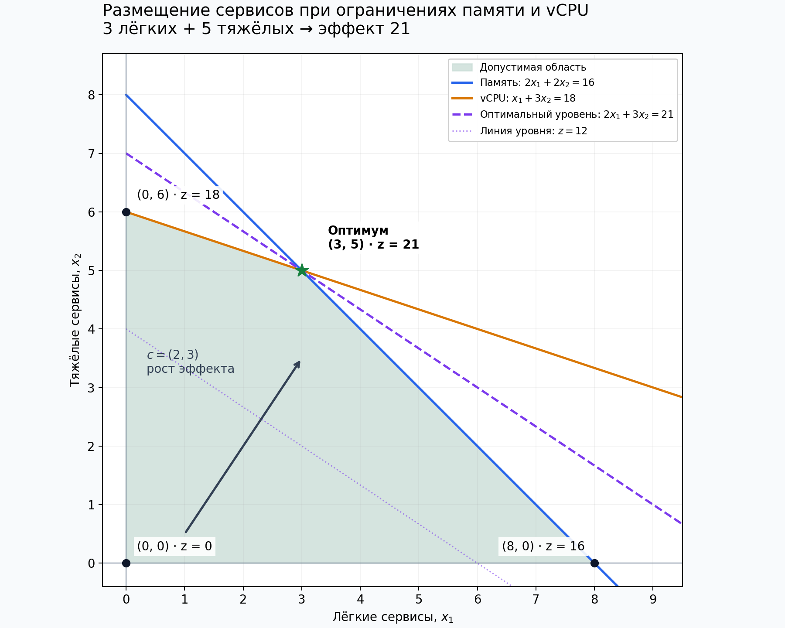

# Размещение инференс-сервисов в кластере

**Ответ: 3 лёгких и 5 тяжёлых сервисов. Максимальный эффект — 21.** Оба ресурса используются полностью.



## Запуск

Нужен Python 3.10 или новее. Выполнить из папки проекта:

```bash
python -m pip install -r requirements.txt
python main.py
```

Программа выводит решение в консоль и сохраняет в папку `results`:

| Файл | Содержание |
|---|---|
| `solution.txt` | Модель, вершины, все базисные решения и словари |
| `solution.json` | Структурированные результаты; точные дроби записаны строками |
| `feasible_region.png` | График допустимой области |
| `feasible_region.svg` | Векторная версия графика |

Расчёт без установки сторонних библиотек:

```bash
python main.py --no-plot
```

Выбор другой папки результатов:

```bash
python main.py --output-dir output
```
Готовые результаты доступны в [docs](docs) ещё до запуска.

## Условие

На узлах кластера размещаются лёгкие и тяжёлые инференс-сервисы. Доступно 16 условных единиц памяти и 18 условных единиц vCPU. Нужно определить количество экземпляров каждого типа, максимизирующее суммарный эффект.

| Показатель на экземпляр | Лёгкий | Тяжёлый | Доступно |
|---|---:|---:|---:|
| Память | 2 | 2 | 16 |
| vCPU | 1 | 3 | 18 |
| Эффект | 2 | 3 | — |

Ниже выполнены все перечисленные на слайде пункты: А, Б и В. Во вводной фразе слайда указаны «четыре части», но отдельной четвёртой части на нём нет.

## А. Формализация

### Стандартная форма

Пусть $x_1$ — количество лёгких сервисов, $x_2$ — количество тяжёлых.

$$
\max z=2x_1+3x_2
$$

при ограничениях

$$
\begin{cases}
2x_1+2x_2\le16, & \text{память},\\
x_1+3x_2\le18, & \text{vCPU},\\
x_1,x_2\ge0.
\end{cases}
$$

Матричная запись: $\max c^Tx$ при $Ax\le b$, $x\ge0$, где

$$
A=\begin{pmatrix}2&2\\1&3\end{pmatrix},\qquad
b=\begin{pmatrix}16\\18\end{pmatrix},\qquad
c=\begin{pmatrix}2\\3\end{pmatrix}.
$$

Стандартная форма содержит неравенства «не больше», каноническая — равенства.

Количество экземпляров по смыслу целое. Для геометрии и базисов сначала решаем непрерывную ЛП-релаксацию. Её оптимум в этой задаче целочисленный, поэтому он одновременно решает задачу размещения целых экземпляров. Округление не требуется.

Модель использует суммарные ресурсы кластера. Вместимости отдельных узлов не заданы, поэтому распределение экземпляров по конкретным узлам не рассматривается.

### Каноническая форма

Вводим $s_1$ — свободную память и $s_2$ — свободные vCPU:

$$
\begin{cases}
2x_1+2x_2+s_1=16,\\
x_1+3x_2+s_2=18,\\
x_1,x_2,s_1,s_2\ge0.
\end{cases}
$$

При порядке переменных $(x_1,x_2,s_1,s_2)$:

$$
\widetilde A=\begin{pmatrix}2&2&1&0\\1&3&0&1\end{pmatrix},
\qquad \widetilde c=\begin{pmatrix}2\\3\\0\\0\end{pmatrix}.
$$

Обе строки независимы, поэтому базис содержит две переменные. Если $s_i=0$, соответствующий ресурс израсходован полностью. Избыточные переменные здесь не нужны: оба исходных ограничения имеют знак «не больше».

## Б. Геометрия

В первой четверти строим прямые $2x_1+2x_2=16$ и $x_1+3x_2=18$. Для каждого ресурсного ограничения выбираем полуплоскость, содержащую начало координат. Их пересечение с условиями неотрицательности — выпуклый четырёхугольник.

| Вершина | Пересекающиеся граничные прямые | Значение $z$ |
|---|---|---:|
| $(0,0)$ | $x_1=0$, $x_2=0$ | 0 |
| $(8,0)$ | $2x_1+2x_2=16$, $x_2=0$ | 16 |
| $(3,5)$ | $2x_1+2x_2=16$, $x_1+3x_2=18$ | **21** |
| $(0,6)$ | $x_1=0$, $x_1+3x_2=18$ | 18 |

Пересечение ресурсных границ:

$$
\begin{cases}x_1+x_2=8,\\x_1+3x_2=18\end{cases}
\quad\Longrightarrow\quad 2x_2=10
\quad\Longrightarrow\quad (x_1,x_2)=(3,5).
$$

Линии уровня цели имеют вид $2x_1+3x_2=z$. Вектор $c=(2,3)$ перпендикулярен им и указывает направление увеличения эффекта. При параллельном переносе линии уровня в направлении $c$ последняя точка её пересечения с допустимой областью — $(3,5)$.

Сравнение значений цели во всех четырёх вершинах подтверждает результат. Область непуста и ограничена, поэтому максимум существует.

## В. Базисные решения и словари

### Все базисные решения

Из четырёх столбцов $\widetilde A$ выбираем два:

$$
\binom{4}{2}=6.
$$

Для каждого набора составляем $B$, проверяем $\det B\ne0$, обнуляем небазисные переменные и решаем $Bx_B=b$. Все шесть наборов являются базисами.

| Базис | Небазисные | $\det B$ | $(x_1,x_2,s_1,s_2)$ | Допустимость | $z$ |
|---|---|---:|---|---|---:|
| $x_1,x_2$ | $s_1,s_2$ | 4 | $(3,5,0,0)$ | Да | **21** |
| $x_1,s_1$ | $x_2,s_2$ | −1 | $(18,0,-20,0)$ | Нет: $s_1<0$ | 36 |
| $x_1,s_2$ | $x_2,s_1$ | 2 | $(8,0,0,10)$ | Да | 16 |
| $x_2,s_1$ | $x_1,s_2$ | −3 | $(0,6,4,0)$ | Да | 18 |
| $x_2,s_2$ | $x_1,s_1$ | 2 | $(0,8,0,-6)$ | Нет: $s_2<0$ | 24 |
| $s_1,s_2$ | $x_1,x_2$ | 1 | $(0,0,16,18)$ | Да | 0 |

Четыре допустимых базисных решения соответствуют четырём вершинам из части Б. Значения 36 и 24 не участвуют в выборе оптимума: соответствующие точки нарушают ограничения. Все допустимые базисные решения невырождены — обе базисные переменные строго положительны.

### Стартовый словарь

Базис — $(s_1,s_2)$, небазисные переменные — $(x_1,x_2)$:

$$
\begin{aligned}
s_1&=16-2x_1-2x_2,\\
s_2&=18-x_1-3x_2,\\
z&=2x_1+3x_2.
\end{aligned}
$$

При $x_1=x_2=0$ получаем $s_1=16$, $s_2=18$, $z=0$. Свободные члены неотрицательны, словарь допустим.

### Два шага смены базиса

**Первый шаг.** Вводим $x_2$: её коэффициент в строке цели равен 3. При $x_1=0$ память допускает $x_2\le16/2=8$, а vCPU — $x_2\le18/3=6$. Минимальное отношение равно 6, поэтому выходит $s_2$.

Выражаем $x_2$ и подставляем в остальные строки:

$$
\begin{aligned}
x_2&=6-\frac13x_1-\frac13s_2,\\
s_1&=4-\frac43x_1+\frac23s_2,\\
z&=18+x_1-s_2.
\end{aligned}
$$

Получена вершина $(0,6)$ со значением цели 18.

**Второй шаг.** Вводим $x_1$, поскольку её коэффициент в строке цели положителен. При $s_2=0$ строка $x_2$ даёт отношение $6/(1/3)=18$, строка $s_1$ — $4/(4/3)=3$. Поэтому выходит $s_1$.

### Оптимальный словарь

Базис — $(x_1,x_2)$, небазисные переменные — $(s_1,s_2)$:

$$
\begin{aligned}
x_1&=3-\frac34s_1+\frac12s_2,\\
x_2&=5+\frac14s_1-\frac12s_2,\\
z&=21-\frac34s_1-\frac12s_2.
\end{aligned}
$$

При $s_1=s_2=0$ получаем $(3,5)$ и $z=21$. Поскольку $s_1,s_2\ge0$,

$$
z=21-\frac34s_1-\frac12s_2\le21.
$$

Это доказательство глобальной оптимальности. Равенство возможно только при $s_1=s_2=0$, а две ресурсные границы однозначно определяют $(3,5)$. Следовательно, оптимум единственный.

## Проверка ответа

| Показатель | Расчёт | Результат |
|---|---|---:|
| Память | $2\cdot3+2\cdot5$ | 16 из 16 |
| vCPU | $1\cdot3+3\cdot5$ | 18 из 18 |
| Эффект | $2\cdot3+3\cdot5$ | **21** |

Ни одно целочисленное размещение не может превысить максимум непрерывной задачи. Найденное решение уже целочисленное и допустимое. Дополнительно программа перебирает все неотрицательные целочисленные пары в пределах $x_1\le8$, $x_2\le6$ и проверяет исходные ограничения.

## Код и проверки

| Файл | Назначение |
|---|---|
| [model.py](model.py) | Точная арифметика, пересечения прямых, базисы, словари и целочисленный перебор |
| [main.py](main.py) | Консольный вывод, сохранение результатов и построение графика |
| [tests/test_model.py](tests/test_model.py) | Проверки модели и тождественности словарей |
| [requirements.txt](requirements.txt) | Matplotlib для графика |
| [docs/solution.txt](docs/solution.txt) | Готовый текстовый результат |
| [docs/solution.json](docs/solution.json) | Готовые структурированные результаты |

Готовый оптимизатор не используется. Системы размера $2\times2$ решаются по формулам Крамера, вычисления выполняются через `fractions.Fraction` из стандартной библиотеки. Вещественные координаты используются только для отрисовки. Базисы, вершины и коэффициенты словарей вычисляются из модели.

Перебор всех базисов прямо требуется в части В; два перехода между словарями отдельно разобраны выше. Универсальный симплекс-решатель не реализуется.

Запуск тестов из папки проекта:

```bash
python -m unittest discover -s tests -v
```

Проверяются все шесть базисов, выполнение равенств, совпадение БДР с геометрическими вершинами, наличие недопустимых решений в таблице, тождественность словарей при ненулевых небазисных переменных, сертификат оптимальности, целочисленный ответ и обработка вырожденной системы уравнений.